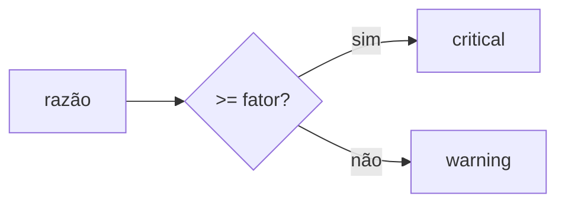

# risk/gradeSeverity

## Visão geral

Gradua um achado pela distância entre a medida e o limite.

## Responsabilidades

- Devolver `critical` quando a razão alcança o fator crítico e `warning` caso contrário.

## Entradas e saídas

```ts
export function gradeSeverity(ratio: number, criticalFactor: number | undefined): RiskSeverity
```

## Fluxo principal



## Tratamento de erros e casos-limite

Sem fator crítico nenhum achado é crítico.

## Exemplos

```ts
gradeSeverity(2, 1.5) // 'critical'
```

## Dependências e integrações

`./types`.
