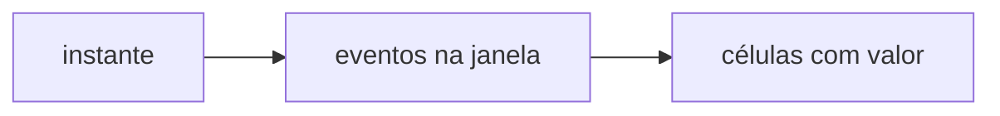

# risk/heatAt

## Visão geral

Calcula o calor acumulado de uma chapa em um instante do plano, sob demanda.

## Responsabilidades

- Somar o comprimento cortado na janela final e dividir o entorno de cada célula pelo limite, de modo que valor acima de 1 passa do limite.
- Dar vistas idênticas ao avançar e voltar no tempo.

## Entradas e saídas

```ts
export function heatAt(request: HeatRequest): HeatView
```

## Fluxo principal



## Tratamento de erros e casos-limite

Sem velocidade ou limite de calor a vista é indisponível e nomeia os caminhos ausentes.

## Exemplos

```ts
const view = heatAt({ ...request, sheetId: 'sheet-1', planSeconds: 12 })
```

## Dependências e integrações

`./heatViewOf` e `./riskContext`.
