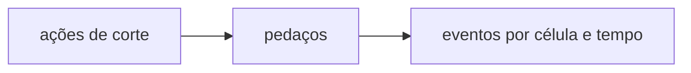

# risk/heatEvents

## Visão geral

Divide o corte de cada chapa em pedaços por célula da grade, com o intervalo de tempo de cada um.

## Responsabilidades

- Usar células de meia unidade do raio de calor.
- Considerar só ações de corte com tempo conhecido.

## Entradas e saídas

```ts
export function heatEvents(context: RiskContext): HeatEventSet[]
```

## Fluxo principal



## Tratamento de erros e casos-limite

Sem o limite de calor devolve lista vazia.

## Exemplos

```ts
const sets = heatEvents(context)
```

## Dependências e integrações

`./riskContext`.
