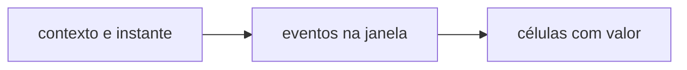

# risk/heatViewOf

## Visão geral

Calcula o calor acumulado de uma chapa em um instante a partir de um contexto já preparado, para a reprodução não reconstruir o contexto a cada quadro.

## Responsabilidades

- Somar o comprimento cortado na janela final e dividir o entorno de cada célula pelo limite.

## Entradas e saídas

```ts
export function heatViewOf(context: RiskContext, sheetId: string, planSeconds: number): HeatView
```

## Fluxo principal



## Tratamento de erros e casos-limite

Sem velocidade ou limite de calor a vista é indisponível e nomeia os caminhos ausentes.

## Exemplos

```ts
const view = heatViewOf(context, 'sheet-1', 12)
```

## Dependências e integrações

`./heatEvents`, `./neighbourhoodLength` e `./riskContext`.
