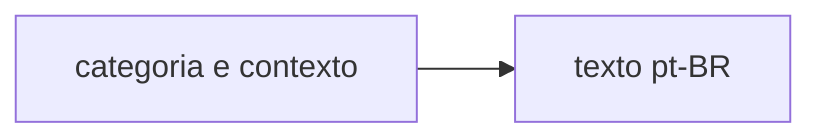

# risk/messages

## Visão geral

Único módulo com os textos de usuário do módulo de risco, em português do Brasil. Interno: não é exportado pelo barril.

## Responsabilidades

- Fornecer o motivo, a sugestão de mitigação e os avisos de cada categoria e código.
- Declarar em um só texto que o resultado é indicativo.

## Entradas e saídas

```ts
export const riskMessages: {
  finding: Record<RiskCategory, (context: RiskMessageContext) => string>
  mitigation: Record<RiskCategory, () => string>
  notice: Record<RiskNoticeCode, (context: RiskMessageContext) => string>
  indicative: () => string
}
```

## Fluxo principal



## Tratamento de erros e casos-limite

Todo código tem texto não vazio. O motivo sempre traz o valor medido, o limite e a unidade.

## Exemplos

```ts
riskMessages.finding['thin-web']({ partKey: 'a#0', otherPartKey: 'b#0', value: 0.5, limit: 1, unit: 'mm' })
```

## Dependências e integrações

`../linking/formatQuantity` e `./types`.
