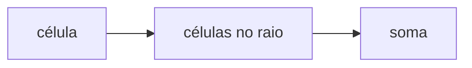

# risk/neighbourhoodLength

## Visão geral

Soma o comprimento de corte das células cujo centro está dentro de um raio do centro de uma célula.

## Responsabilidades

- Dar meia célula de folga ao raio.

## Entradas e saídas

```ts
export function neighbourhoodLength(totals, cx, cy, cellSize, radius): number
```

## Fluxo principal



## Tratamento de erros e casos-limite

Células sem corte contam zero.

## Exemplos

```ts
const length = neighbourhoodLength(totals, 3, 4, 15, 30)
```

## Dependências e integrações

Nenhuma.
