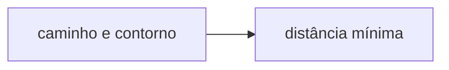

# risk/pathDistance

## Visão geral

Menor distância entre um caminho e o contorno de um polígono; zero quando o caminho cruza o contorno ou está dentro dele.

## Responsabilidades

- Medir segmento contra aresta.

## Entradas e saídas

```ts
export function pathDistance(path: readonly Point2D[], ring: readonly Point2D[]): number
```

## Fluxo principal



## Tratamento de erros e casos-limite

Um caminho com um único ponto é tratado como ponto.

## Exemplos

```ts
const distance = pathDistance(action.path, part.outline)
```

## Dependências e integrações

`../polygonUtils`.
