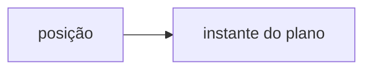

# risk/planTimeAt

## Visão geral

Converte uma posição de reprodução em instante do plano.

## Responsabilidades

- Interpolar dentro da ação corrente e devolver o fim do plano quando a reprodução terminou.

## Entradas e saídas

```ts
export function planTimeAt(context: RiskContext, sheetId: string, actionIndex: number, progress: number): number | null
```

## Fluxo principal



## Tratamento de erros e casos-limite

Tempos indisponíveis resultam em nulo.

## Exemplos

```ts
const seconds = planTimeAt(context, 'sheet-1', 4, 0.5)
```

## Dependências e integrações

`./riskContext`.
