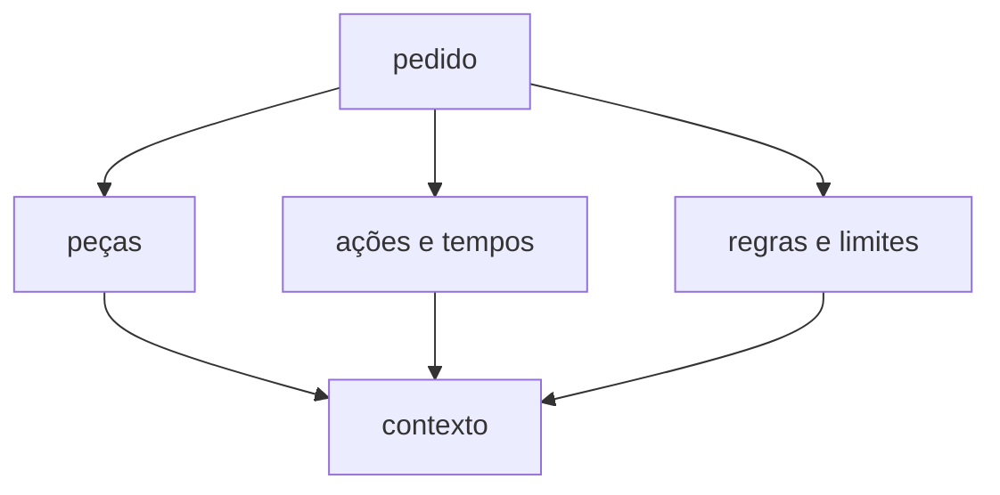

# risk/riskContext

## Visão geral

Deriva uma vez tudo que as regras leem: peças posicionadas com área líquida, ações com caminho amostrado, comprimento, tempos e peça dona, limites em unidades SI e quais regras podem ser avaliadas.

## Responsabilidades

- Vincular ações a peças com o mesmo vínculo da revisão e do custo.
- Informar, por regra, quais entradas do perfil faltam.
- Não alterar o pedido.

## Entradas e saídas

```ts
export function buildRiskContext(request: RiskRequest): RiskContext
```

## Fluxo principal



## Tratamento de erros e casos-limite

Um grupo de limites só existe quando todos os valores que ele exige foram informados.

## Exemplos

```ts
const context = buildRiskContext({ artifact, layout, cutPlan, profile })
```

## Dependências e integrações

`../linking` e `./actionTimes`.
