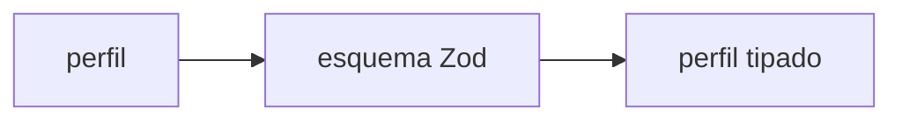

# risk/schemas

## Visão geral

Esquema Zod do perfil de risco de corte, alinhado ao tipo `CutRiskProfile`, no mesmo uso de fronteira do chamador que o perfil de custo.

## Responsabilidades

- Validar a forma do perfil recebido; as faixas de valor ficam em `validateRiskProfile`.
- Ignorar campos desconhecidos.

## Entradas e saídas

```ts
export const riskProfileSchema: z.ZodObject<...>
```

## Fluxo principal



## Tratamento de erros e casos-limite

Um perfil sem `contractVersion` 1 ou sem `geometryUnitsPerMeter` numérico é recusado.

## Exemplos

```ts
riskProfileSchema.safeParse(profile)
```

## Dependências e integrações

`zod`.
