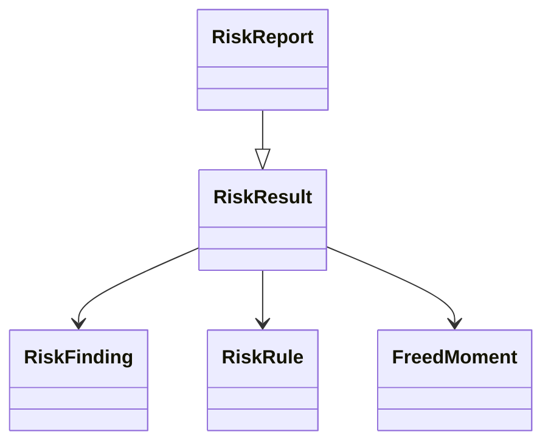

# risk/types

## Visão geral

Tipos públicos do módulo de risco: perfil de limites, pedido, achados, regras, momentos de liberação, resultado e relatório com digests, e a visão de calor.

## Responsabilidades

- Definir o contrato de dados da avaliação, sem lógica.
- Documentar as faixas do perfil: `geometryUnitsPerMeter` finito e maior que zero; `heat.radius`, `heat.windowSeconds`, `heat.maxCutLength`, `web.minimum`, `loosePart.maxArea` e `headStrike.clearance` maiores que zero; `criticalFactor` maior que 1.
- Declarar que todo resultado é indicativo (`indicative: true`).

## Entradas e saídas

```ts
export interface CutRiskProfile { contractVersion: 1; geometryUnitsPerMeter; speeds?; heat?; web?; loosePart?; headStrike?; criticalFactor?; source? }
export interface RiskFinding { id; category; severity; sheetId; measured; limit; unit; message; mitigation }
export interface RiskResult { status; indicative: true; findings; rules; freedMoments; notices }
```

## Fluxo principal



## Tratamento de erros e casos-limite

Os tipos não validam valores; a validação fica em `validateRiskProfile` e no esquema Zod.

## Exemplos

```ts
const finding: RiskFinding['category'] = 'thin-web'
```

## Dependências e integrações

Tipos de `../erp`, `../cutPath` e `../cost`.
