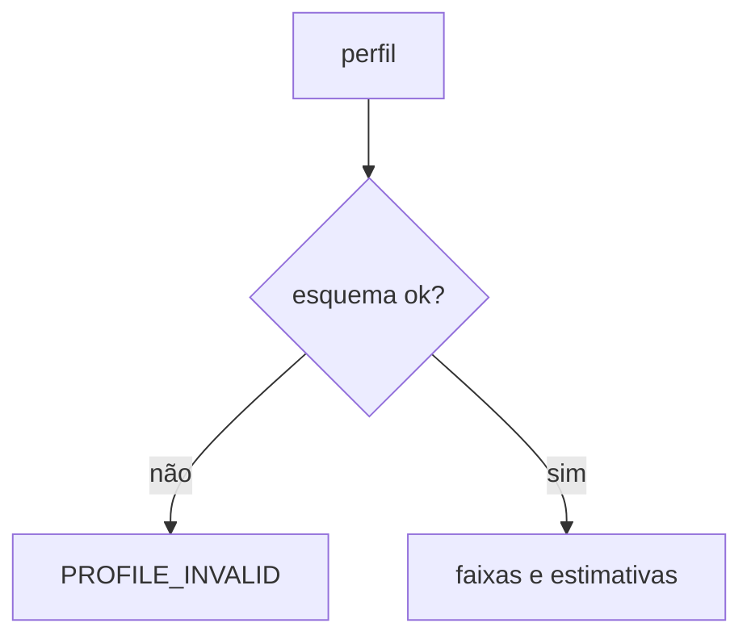

# risk/validateRiskProfile

## Visão geral

Valida um perfil de risco além do esquema: unidade e limites finitos e positivos, fator crítico maior que 1, e avisa quando um valor é uma estimativa.

## Responsabilidades

- Devolver `PROFILE_INVALID` com o caminho do campo inválido.
- Devolver `ESTIMATED_LIMIT` para cada valor marcado como estimado.
- Nunca alterar o perfil.

## Entradas e saídas

```ts
export function validateRiskProfile(profile: CutRiskProfile): RiskNotice[]
```

## Fluxo principal



## Tratamento de erros e casos-limite

O tempo de perfuração aceita zero; os demais limites exigem valor maior que zero.

## Exemplos

```ts
const notices = validateRiskProfile(profile)
```

## Dependências e integrações

`./schemas` e `./messages`.
